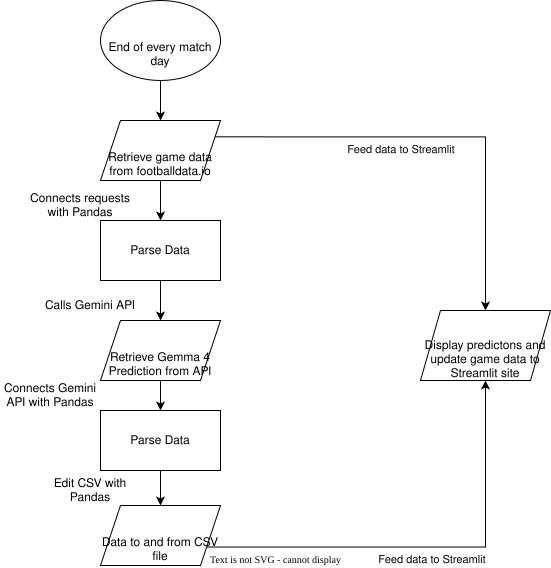

# AI_Football

An AI-powered Premier League match predictor that compares language-model predictions with final match results.

## The Problem

Football fans and fantasy players often rely on intuition or fragmented information to predict match outcomes. AI_Football aims to give an English Premier League match an automated second opinion, preserve each model's prediction, and score it against the actual result so that model performance can be compared over time.

## How It Works

The Streamlit app loads fixtures and saved results from local CSV storage, refreshes Premier League data through FootballData.io, and sends match context to registered prediction providers. The current provider is Gemma 4. Predictions are stored in `Code/predictions.csv`; completed fixtures are compared with their actual outcome and scored in `Code/scores.csv`. A background scheduler also predicts tomorrow's fixtures once per day at 06:00 while the app is running.



The request flow is:

1. `Code/app.py` starts the dashboard and its daily prediction scheduler.
2. `Code/main.py` coordinates fixture refreshes, prediction calls, storage, and scoring.
3. `Code/football_data.py` retrieves fixtures and results from FootballData.io.
4. `Code/prediction.py` discovers provider modules and prevents duplicate predictions.
5. `Code/gemma4_prediction.py` builds a pre-match prompt for Gemma 4 and saves available outcomes.
6. `Code/scoring.py` awards 1 point for a home win, draw, or away win prediction that matches the final result.
7. `Code/storage.py` persists fixtures, predictions, and scores in process-safe CSV files.

## Tech Stack

- **Language:** Python 3
- **Dashboard:** Streamlit
- **Data and charting:** pandas, Altair
- **Scheduling:** APScheduler
- **API and environment tools:** requests, python-dotenv
- **AI:** Google Gen AI SDK with Gemma 4 (`gemma-4-26b-a4b-it`)
- **External data:** [FootballData.io](https://footballdata.io/) Premier League API
- **Data storage:** CSV files with file locks and atomic writes

## Setup and Run

### 1. Prerequisites

Install:

- Python 3.10 or newer
- `git`
- A Google AI API key with access to `gemma-4-26b-a4b-it`
- A FootballData.io API key

### 2. Clone the repository

```bash
git clone https://github.com/Phil-Liao/AI_Football.git
cd AI_Football
```

### 3. Create a virtual environment

macOS/Linux:

```bash
python3 -m venv .venv
source .venv/bin/activate
```

Windows:

```powershell
py -m venv .venv
.venv\Scripts\activate
```

### 4. Install dependencies

From the repository root:

```bash
python -m pip install --upgrade pip
python -m pip install -r Code/requirements.txt
```

### 5. Configure API credentials

Create `Code/.env` from the included template:

macOS/Linux:

```bash
cp Code/.env.example Code/.env
```

Windows PowerShell:

```powershell
Copy-Item Code/.env.example Code/.env
```

Open `Code/.env` and replace both placeholders:

```dotenv
GOOGLE_API_KEY=your_google_ai_api_key
FOOTBALLDATAIO_KEY=your_footballdata_io_api_key
```

Keep `Code/.env` private. It is ignored by Git.

### 6. Start the dashboard

```bash
streamlit run Code/app.py
```

Open the local URL printed by Streamlit, usually `http://localhost:8501`. The app loads existing CSV data immediately. Use **Refresh fixtures** to retrieve yesterday's and tomorrow's Premier League matches, or use **Predict missing** to generate and store predictions that do not already exist.

The dashboard starts a daily prediction job at 06:00 in the host's local timezone. It remains active while the Streamlit process is running.

### Example input and output

Input to the prediction provider:

```text
Kickoff: 2026-11-21 15:00:00
Home team: Aston Villa
Away team: Sunderland
```

A valid model response is a short exact outcome:

```text
Draw
```

The response is stored in `Code/predictions.csv` in a row similar to:

```csv
match_id,match_date,home_team,away_team,model,prediction,prompt_version,status
740533379,2026-11-21 15:00:00,Aston Villa,Sunderland,gemma-4-26b-a4b-it,Draw,2,stored
```

After the match completes, `Code/scores.csv` records the actual outcome and points:

```csv
match_id,model,prediction,actual_outcome,points,status
740533379,gemma-4-26b-a4b-it,Draw,Draw,1,scored
```

### Run tests

From the repository root:

```bash
PYTHONPATH=Code python3 -m unittest discover -s Code/Testing -p '*_test.py'
```

On Windows PowerShell, set the import path first:

```powershell
$env:PYTHONPATH="Code"
python -m unittest discover -s Code/Testing -p '*_test.py'
```

Some tests make API requests and require valid credentials in `Code/.env`.

## Roadmap

- [x] Build the Streamlit Premier League dashboard
- [x] Integrate FootballData.io fixture and result retrieval
- [x] Integrate Google Gen AI Gemma 4 predictions
- [x] Store fixtures, predictions, and scores in CSV files
- [x] Score completed matches and build a leaderboard
- [x] Schedule daily predictions at 06:00
- [x] Add process-safe CSV locking and atomic writes
- [x] Add provider discovery and model-neutral prediction orchestration
- [x] Add unit tests for storage, API clients, scoring, and prediction flows
- [x] Add walkthrough video
- [x] Add multiple prediction models
- [ ] Add fantasy football substitution and transfer policies
- [x] Add automated cloud deployment

## Demo

[Watch the project video walkthrough](https://canva.link/wzd5twdhks5b1hc)
